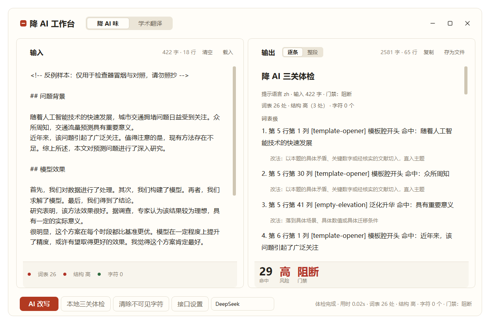

# deai-writing

[中文](README.md) | English

Three runnable gates for any Chinese or English draft: remove the AI-slop habits, and remove the invisible watermark characters. The rules run, re-check and regress on their own, so you do not have to rely on how a draft feels. The same engine also ships as a desktop workbench: local checks, model rewrite and academic translation, closed in one window.

[](LICENSE)


## What it does

| Gate | Tool | What it checks | When it fails |
|---|---|---|---|
| **Word list** | `code/check_phrasing.py`<br>rules in `code/phrasing-blacklist.json` | Template openers, filler, empty claims and fake-insight phrasing: 21 rules across Chinese and English | Exits 1 on any hit and prints the fix for each one |
| **Structure** | `code/check_style.py` | Over-long passive sentences, repeated openings, transition density, long-to-short sentence ratio, paragraph rhythm, decimal places | Exits 1 on any hit; a risk level of `high` or `very high` blocks delivery |
| **Characters** | `code/strip_invisible.py` | Zero-width characters, bidi controls, tag characters, variation selectors | Final artifacts must re-check at exit 0 after cleaning |

**Scope.** It only touches wording and characters. Facts, data and conclusions stay as they are. De-slopping is not the same as making writing casual; the test is whether only this author could have written the sentence, drawn from that author's own judgements, numbers and limits.

## Desktop workbench

`desktop/` puts the same three-gate engine into a frameless Qt workbench (PySide6), styled as a warm-paper editing desk with ink text and a cinnabar primary action:



- **Local three-gate check** without any model call: word-list / structure / character chips and the hits / risk / verdict numbers colour instantly, matching the CLI line by line.
- **AI rewrite** over any OpenAI-compatible endpoint, streamed on a background thread; each round re-checks locally and feeds the hits and fixes back to the model. A round-progress label shows while generating; Esc or "stop" interrupts at any time.
- **Academic translation** crosses the language first, then runs the same de-AI loop automatically; if the de-AI stage fails or is stopped, the translation draft is kept and "retry de-AI" re-runs only that stage.
- **Interactive report**: in the itemised view every hit is clickable and moves the input cursor to that line with a brief highlight; past 30 hits, "N more" expands on click; the whole-text view marks hits in place without changing a single visible character.
- **Small conveniences**: a draggable pane splitter whose ratio is remembered; drop drafts straight into the input pane; provider and translation-direction controls live on the main window; long hints can be dismissed; window geometry is remembered.

Setup, motion and packaging live in [desktop/README.md](desktop/README.md). The only third-party runtime dependency is PySide6-Essentials; the API calls and the three gates use the standard library.

## What it looks like

Run it against the fixture that ships with the repository. `examples/slop-sample-en.md` is a deliberately broken English sample:

```console
$ python3 code/check_phrasing.py --lang en examples/slop-sample-en.md
examples/slop-sample-en.md:6:1 [en-slop-phrase] In today's world (occurrence #1, over the limit of 0)
    → Delete the preamble and state the conclusion; if a transition is needed, make it carry information.
examples/slop-sample-en.md:6:30 [en-slop-word] leverage (occurrence #1, over the limit of 0)
    → Use a concrete verb or fact: leverage becomes use, streamline becomes cut steps, cutting-edge becomes new.
...
examples/slop-sample-en.md:10:8 [en-slop-pattern] what nobody tells you (occurrence #4, over the limit of 0)
    → State the conclusion, name the source, give the fact; stop on the last concrete point.
examples/slop-sample-en.md:18:101 [en-slop-pattern] to sum up (occurrence #11, over the limit of 0)
    → State the conclusion, name the source, give the fact; stop on the last concrete point.
Checked 1 file(s); 29 hit(s) (word list: 21 rules)
```

It exits 1. Rewrite each hit along the fix printed after `→`, then re-check until both checkers exit 0.

Messages print in Chinese by default. `--lang en` switches the messages, the rule labels and the fix hints to English; `docs/deai-rules.md` stays the authoritative specification and is written in Chinese.

## Quick start

### Install

Drop this repository into your agent's skills directory:

```
<project>/.trae/skills/deai-writing/
```

The scripts use the Python standard library only, plus PyMuPDF for PDF mode (`pip install pymupdf`). No host framework required. The full self-check passes on Python 3.13 and 3.14.

### Run the three gates

```bash
python3 code/check_phrasing.py draft.md                # word list: exits 1 on any hit
python3 code/check_style.py draft.md                   # structure: exits 1 on any hit
python3 code/strip_invisible.py --clean draft.tex      # characters: clean in place, keep a .bak
python3 code/check_phrasing.py --list-rules            # show the rules and their fixes
python3 code/check_style.py --list-metrics             # show the metrics and thresholds
python3 code/check_phrasing.py draft.md --lang en      # English messages, rule labels and fixes
```

A rule carrying `max_per_document` is a frequency cap, and only uses above the cap count as hits. Do not ship while the structural risk level reads `high` or `very high`. The final PDF and Word file must both be cleaned and re-checked; a `CLEANED-RESIDUAL` report means do not ship.

### Regression self-check

```bash
python3 code/selfcheck.py                              # 12 assertions: fixtures, doc self-check, character round-trip
```

Run it whenever you change the word list, a threshold or a fixture. The desktop side adds 279 headless tests (UI geometry, motion degradation and end-to-end rewrite); the commands live in [desktop/README.md](desktop/README.md).

## Repository layout

```
deai-writing/
├── SKILL.md                       # Entry point: scope, three gates, quick flow, hard requirements
├── README.md                      # Chinese README: quick start, layout, rationale, conventions
├── README.en.md                   # This file: the same structure in English
├── desktop/                       # Desktop app: frameless Qt UI, rewrite and translation, exe build
│   ├── deai_app/                  #   ui / core / bridge layers plus assets (theme, example providers)
│   ├── tests/                     #   279 headless tests: contracts, geometry, motion, end-to-end
│   ├── build/                     #   PyInstaller manifest and build scripts
│   └── screenshots/               #   UI screenshots used by the READMEs
├── code/                          # Runnable scripts and data
│   ├── check_phrasing.py          #   Word-list checker: template openers, filler, empty claims, fake insight
│   ├── phrasing-blacklist.json    #   Chinese and English rules (single source of truth; add words here only)
│   ├── check_style.py             #   Structural checker: six metrics plus a risk level
│   ├── strip_invisible.py         #   Character cleaner: tex, docx, pdf and plain text
│   └── selfcheck.py               #   Regression self-check: asserts the expected exit code of every fixture
├── docs/                          # Specifications
│   ├── deai-rules.md              #   Chinese rules, the authoritative source: hint list, rewrite rules, negative list, voice preservation, abstract de-templating, structural details, character cleaning
│   └── no-ai-slop-reference.md    #   English reference: slop pattern catalogue and rule mapping (MIT, source SHA and notice kept)
└── examples/                      # Reproducible fixtures
    ├── clean-sample.md            #   Chinese positive: both checkers must report zero
    ├── clean-sample.tex           #   Chinese positive in LaTeX, covering the .tex code path
    ├── slop-sample.md             #   Chinese negative: dense word-list hits
    ├── style-slop-sample.md       #   Chinese negative: dense structural hits
    ├── clean-sample-en.md         #   English positive
    └── slop-sample-en.md          #   English negative: dense en-slop hits
```

## Relationship to upstream

The English slop pattern catalogue and its sentence-level taxonomy come from [petergyang/no-ai-slop](https://github.com/petergyang/no-ai-slop). This repository adds three things on top:

- The catalogue turned into 21 runnable rules that cover Chinese and English; adding a word means editing `code/phrasing-blacklist.json` only.
- Chinese rules, plus the structural and character gates, so a vague sense of AI-ness becomes a reproducible exit code.
- Fixtures wired to `code/selfcheck.py`, so an expected-result table that used to be checked by eye now fails when it drifts.

## Layout rationale

- **Top level split by content type**: `code/`, `docs/`, `examples/`. The vocabulary is stable across searches: `code/` is always runnable scripts and data, `docs/` is always specification, `examples/` is always reproducible fixtures.
- **`desktop/` is the application directory**: desktop sources, tests and build scripts only. It is not part of the skill vocabulary, and the three content types above keep their meaning.
- **The word list is data, not code**: `code/phrasing-blacklist.json` is read by the checker and can also be consumed by third-party programs. Adding a word means editing that one file, and `check_phrasing.py` plus `docs/deai-rules.md` follow.
- **Two levels deep at most**: files sit directly under `code/`, `docs/` and `examples/` (`desktop/` follows Python package layout and is exempt).

## Extending it

Checklist for adding a rule or a cleaning rule set:

```
code/phrasing-blacklist.json    # add one entry under rules (id/label/severity/why/fix/patterns/max_per_document, plus label_en/why_en/fix_en)
docs/deai-rules.md              # document it in one line (counter-examples stay in backticks so the doc self-checks)
examples/                       # add a positive or negative fixture when needed
python3 code/selfcheck.py       # run the regression and confirm every assertion still passes
```

Conventions:

- Every word-list rule carries `why` (why it reads as a hint) and `fix` (how to rewrite it). The checker prints both, so every hit arrives with a repair.
- Structural thresholds live in the constants at the top of `code/check_style.py`. Changing one means updating `docs/deai-rules.md` and the expected results in `examples/`.
- Patterns use Python `re` syntax. A broken pattern must raise rather than be skipped, so rules are pre-compiled at load time.
- Counter-examples inside the specification docs stay wrapped in backticks, which keeps those files passing the word-list check.
- Every script exposes an `argparse` entry point and uses the same exit codes: `0` pass, `1` check failed, `2` usage or environment error.
- Run `python3 code/selfcheck.py` after adding or changing a fixture.

## Credits and license

The rule system here builds on two upstream projects. What was taken from each:

**petergyang/no-ai-slop** (MIT, by Peter Yang)

Taken: the English slop pattern taxonomy and the editing principles, covering binary contrasts, colon reveals, fake-insight setups, fake-profound kickers and decorative formatting. The adapted catalogue is [`docs/no-ai-slop-reference.md`](docs/no-ai-slop-reference.md), which keeps the upstream URL, commit `000650b156983f5159695b441477f4e63b25dc85` and the full MIT notice.

**guillaumemeyer/watermarks-remover** (MIT)

Taken: the invisible-character set and the IVD protection logic in `code/strip_invisible.py`, ported from Layer A (`service/scripts/text_unicode.py`). The upstream copyright and the full MIT license text sit in that file's header.

What this repository adds on top: the Chinese word-list rules, the structural and character gates, and `code/selfcheck.py`, which pins the fixtures down as assertions.

**License**: this repository is released under [MIT](LICENSE). Keep the upstream notices when you redistribute it. The full upstream MIT text for the slop taxonomy sits in `docs/no-ai-slop-reference.md`, and the upstream copyright and license covering the character set are reproduced in the header of `code/strip_invisible.py`.
