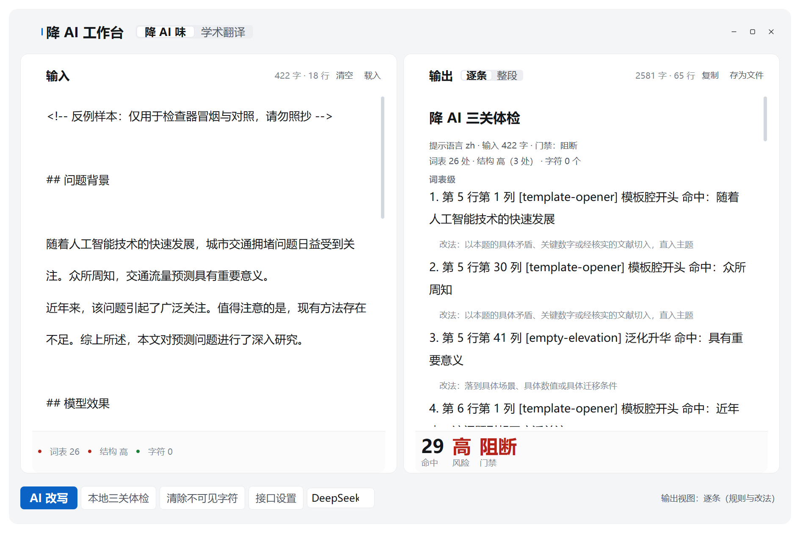
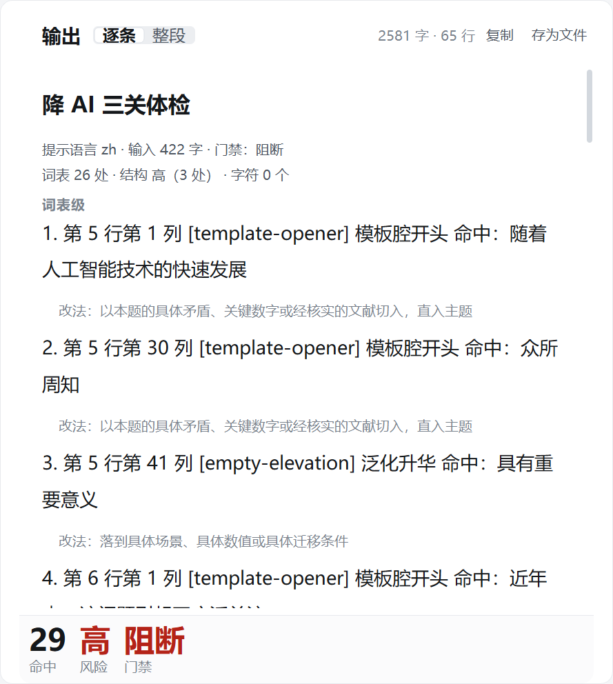

<p align="center">
  
</p>

<h1 align="center">deai-writing</h1>

<p align="center">
  <picture>
    <source media="(prefers-color-scheme: dark)" srcset="assets/hero-dark.png">
    
  </picture>
</p>

<p align="center"><a href="README.md">中文</a> | <a href="README.en.md">English</a></p>

<p align="center">
  <a href="https://github.com/Escap1ng/deai-writing/releases/tag/v0.1.0"></a>
  
  <a href="LICENSE"></a>
  
  
  
  
</p>

给中文或英文文稿过三道可执行门禁：词表查模板腔与套话，结构查句式与节奏，字符清零宽与 bidi 隐写。命中即退出 1，每条命中附改法；正反例固化成断言，改错就红。同一套引擎也是桌面工作台：本地体检、模型改写、学术翻译，一个窗口闭环。

## 三道门禁

| 关 | 工具 | 检查什么 | 门禁 |
|---|---|---|---|
| **词表级** | `code/check_phrasing.py`<br>词表 `code/phrasing-blacklist.json` | 模板腔、套话、空泛、伪洞察等用词与句式，21 条中英规则 | 命中即退出 1，每条命中都附改法 |
| **结构级** | `code/check_style.py` | 过长被动句、句式重复、过渡词密度、长短句比例、相邻段落节奏、结果小数位 | 命中即退出 1；风险「高/极高」不得交付 |
| **字符级** | `code/strip_invisible.py` | 零宽字符、bidi 控制、tag 字符、变体选择符等不可见 Unicode | 交付产物清理后复检必须退出 0 |

**边界**：只处理表述与字符，不改动事实、数据与结论。去 AI 味不等于口语化，判据是「只有这位作者写得出」，来自作者本人的具体判断、具体数值与具体边界。

## 快速开始

### 安装

作为 agent 技能，把本仓库放进技能目录：

```
<project>/.trae/skills/deai-writing/
```

或直接克隆运行（桌面工作台需要 PySide6-Essentials）：

```bash
git clone https://github.com/Escap1ng/deai-writing.git
cd deai-writing
```

检查脚本只用 Python 标准库，PDF 模式额外需要 PyMuPDF（`pip install pymupdf`），不依赖宿主框架。全部自检已在 Python 3.13 与 3.14 上跑通。

### 跑三道关

```bash
python3 code/check_phrasing.py draft.md                # 词表级：命中即退出 1
python3 code/check_style.py draft.md                   # 结构级：命中即退出 1
python3 code/strip_invisible.py --clean draft.tex      # 字符级：就地清理并留 .bak
python3 code/check_phrasing.py --list-rules            # 查看词表规则与改法
python3 code/check_style.py --list-metrics             # 查看结构指标与阈值
python3 code/check_phrasing.py draft.md --lang en      # 英文提示、英文规则标签与改法
python3 code/check_style.py draft.md --json            # 结构化输出，便于程序消费
```

带 `max_per_document` 的是频次上限，超出上限的部分才算命中。退出码统一为 `0` 通过 / `1` 校验失败 / `2` 用法或环境错误。最终 PDF 与 Word 必须清理后复检，复检仍报 `CLEANED-RESIDUAL` 不得交付。

### 回归自检

```bash
python3 code/selfcheck.py                              # 12 项断言：正反例 + 规范文档自检 + 字符级闭环
cd desktop && python3 -m unittest discover -s tests -t .   # 桌面端 279 项无头测试
```

改过词表、阈值或示例后必跑 `selfcheck.py`。桌面端测试含界面几何、动效降级与端到端改写，命令与口径见 [desktop/README.md](desktop/README.md)。

## 实测输出

以下数字均为本仓库当前代码的真实运行结果（Python 3.14，Windows）：

| 命令 | 实测结果 | 退出码 |
|---|---|---|
| `check_phrasing.py examples/slop-sample.md` | 命中 26 处（词表 21 条规则） | 1 |
| `check_style.py examples/style-slop-sample.md` | 命中 8 处，风险 极高 | 1 |
| `check_phrasing.py --lang en examples/slop-sample-en.md` | 29 hits（word list: 21 rules） | 1 |
| `check_phrasing.py examples/clean-sample.md` | 未命中 | 0 |
| `check_style.py examples/clean-sample.md` | 未命中，风险 低 | 0 |
| `code/selfcheck.py` | 12 项断言全过 | 0 |
| `desktop` 测试套件 | 279 项全过 | 0 |

中文反例 `examples/slop-sample.md` 是刻意写坏的样本，词表级逐条报出并附改法：

```console
$ python3 code/check_phrasing.py examples/slop-sample.md
examples/slop-sample.md:5:1 [template-opener] 随着人工智能技术的快速发展（第 1 次出现，超过上限 0）
    → 以本题的具体矛盾、关键数字或经核实的文献切入，直入主题
examples/slop-sample.md:5:30 [template-opener] 众所周知（第 2 次出现，超过上限 0）
    → 以本题的具体矛盾、关键数字或经核实的文献切入，直入主题
…
检查 1 个文件，命中 26 处（词表：21 条规则）
```

英文反例走 `--lang en`，提示、规则标签与改法一并切换：

```console
$ python3 code/check_phrasing.py --lang en examples/slop-sample-en.md
examples/slop-sample-en.md:6:1 [en-slop-phrase] In today's world (occurrence #1, over the limit of 0)
    → Delete the preamble and state the conclusion; if a transition is needed, make it carry information.
examples/slop-sample-en.md:6:30 [en-slop-word] leverage (occurrence #1, over the limit of 0)
    → Use a concrete verb or fact: leverage becomes use, streamline becomes cut steps, cutting-edge becomes new.
…
Checked 1 file(s); 29 hit(s) (word list: 21 rules)
```

按输出里 `→` 之后的改法提示改写，改完复检，两个检查器都退出 0 才算过。`docs/deai-rules.md` 是唯一权威规范，中文写成；`--lang en` 只切换运行期提示。

## 桌面工作台

`desktop/` 把同一套三关引擎装进无边框 Qt 工作台（PySide6）：浅灰工作区、白色双栏、单一蓝色强调，正文 13pt。



- **本地三关体检**不调模型：词表 / 结构 / 字符三枚 chips 与命中 / 风险 / 门禁三个数字即时上色，口径与命令行逐条一致。
- **AI 改写**走 OpenAI 兼容接口，后台流式输出，每轮结束本地复检、把命中与改法回灌模型；生成期有轮次进度标签，Esc 或「停止生成」随时中断。
- **学术翻译**先跨语言、再自动过同一套降 AI 闭环；降 AI 段失败或停止时译文草稿保留，「重试降 AI」只重跑该段。
- **报告可交互**：逐条视图每条命中可点击，输入栏光标跳到对应行并整行高亮；超过 30 条时「另有 N 处」点击展开；整段视图就地标色，不改动一个可见字符。
- **顺手的小事**：双栏分隔条可拖动且比例记忆；稿子直接拖进输入栏；供应商下拉与翻译方向前置到主界面；长提示条可收起；窗口几何记忆。

右栏逐条报告放大看：每条命中带规则名、行列位置与改法，底部带给出命中 / 风险 / 门禁三个数字。



```bash
cd desktop
python3 -m deai_app                 # 源码运行
python3 -m deai_app --smoke         # 无界面自检（5/5）
python3 build/build.py              # 目录版 exe：build/dist/deai/deai.exe
python3 build/build.py --onefile    # 单文件版 exe：build/dist/deai.exe
```

运行时第三方依赖只有 PySide6-Essentials，接口调用与三关引擎全部标准库。安装、动效与打包细节见 [desktop/README.md](desktop/README.md)。

## 目录结构

```
deai-writing/
├── SKILL.md                       # 技能入口：定位、三道关、快速流程、强制项摘要
├── README.md                      # 本文件（中文）
├── README.en.md                   # 英文版，与 README.md 同构
├── assets/                        # README 配图源与导出（hero 深浅两版、应用图标）
├── desktop/                       # 桌面应用：无边框 Qt 界面、改写与翻译、exe 打包
│   ├── deai_app/                  #   ui / core / bridge 三层 + assets（主题、图标、示例配置）
│   ├── tests/                     #   279 项无头测试：契约、几何、动效、端到端
│   ├── build/                     #   PyInstaller 打包清单与脚本
│   └── screenshots/               #   界面截图（README 配图）
├── code/                          # 可执行脚本与数据
│   ├── check_phrasing.py          #   词表级检查器：扫模板腔、套话、空泛、伪洞察，命中退出 1
│   ├── phrasing-blacklist.json    #   中英词表与句式规则（单一事实源，加词只改它）
│   ├── check_style.py             #   结构级检查器：六项指标 + 风险等级
│   ├── strip_invisible.py         #   字符级清理器：覆盖 tex/docx/pdf 与纯文本
│   └── selfcheck.py               #   回归自检：对 examples/ 全部正反例断言期望退出码
├── docs/                          # 规范
│   ├── deai-rules.md              #   降 AI 规范（唯一权威）：痕迹清单、改写规则、负面清单、个人声音保留、结构级细则、字符级清理
│   ├── icon.html                  #   图标工坊：参数化图标预览与导出
│   └── no-ai-slop-reference.md    #   英文参考：slop 模式清单与规则映射表（MIT，含来源 SHA 与版权声明）
└── examples/                      # 可复现示例
    ├── clean-sample.md            #   中文正例：词表级与结构级都应零命中
    ├── clean-sample.tex           #   中文正例（LaTeX 载体）：覆盖脚本的 .tex 代码路径
    ├── slop-sample.md             #   中文反例：词表级痕迹密集
    ├── style-slop-sample.md       #   中文反例：结构级痕迹密集
    ├── clean-sample-en.md         #   英文正例
    └── slop-sample-en.md          #   英文反例：en-slop-* 规则密集
```

目录词表跨技能检索语义不变：`code/` 恒为「可执行脚本与数据」，`docs/` 恒为「规范」，`examples/` 恒为「可复现示例」；`desktop/` 是应用目录，不参与技能检索；`assets/` 只放 README 配图。`code/` `docs/` `examples/` 下方直接放文件，层级最深 2 层（`desktop/` 按 Python 包结构组织，不受此限）。词表是数据不是代码：`phrasing-blacklist.json` 既可被检查器读取，也可被第三方程序消费，加词只改这一处。

## 扩展约定

新增规则或清理规则集的交付清单：

```
code/phrasing-blacklist.json    # 在 rules 里加一条（id/label/severity/why/fix/patterns/max_per_document，另配 label_en/why_en/fix_en）
docs/deai-rules.md              # 对应补一行说明（反例写成行内代码，检查器会跳过，故文档可自检）
examples/                       # 必要时补正例或反例 fixture
python3 code/selfcheck.py       # 跑回归，确认全部断言仍通过
```

- 词表规则一律带 `why`（为什么算痕迹）与 `fix`（怎么改），检查器输出直接引用，保证「报出即有改法」。
- 结构级阈值写在 `code/check_style.py` 头部常量；调整后须同步 `docs/deai-rules.md` 与 `examples/` 的期望结果。
- 正则用 Python `re` 语法；写错正则应报错而不是静默跳过，规则加载时统一预编译。
- 规范文档里出现的反例一律用反引号包成行内代码，使其自身通过词表级自检。
- 脚本一律提供 `argparse` 入口，退出码统一为 `0` 成功 / `1` 校验失败 / `2` 用法或环境错误。
- 新增或修改示例后必须跑 `python3 code/selfcheck.py`。

## 上游与许可

规则体系建立在两个上游项目之上，各自取用的部分如下。

**petergyang/no-ai-slop**（MIT，作者 Peter Yang）：取用英文 slop 模式分类与编辑原则，包括二元对照、冒号揭晓、伪洞察铺陈、虚假深刻收尾、装饰性排版等类别。整理稿见 [`docs/no-ai-slop-reference.md`](docs/no-ai-slop-reference.md)，保留上游 URL、commit `000650b156983f5159695b441477f4e63b25dc85` 与 MIT 声明全文。

**guillaumemeyer/watermarks-remover**（MIT）：取用不可见字符集与 IVD 保护逻辑，落在 `code/strip_invisible.py`，移植自上游 Layer A 的 `service/scripts/text_unicode.py`；该文件头部附有上游版权声明与 MIT 许可全文。

本仓库在上游之上的增量：把清单整理成 21 条可执行的中英词表（加词只改 `code/phrasing-blacklist.json` 一处）；补上中文规则以及结构级、字符级两道门禁，让「AI 味」从主观印象变成可复现的退出码；把正反例固化成 `code/selfcheck.py` 的断言，原来靠人眼对照的期望结果现在写错就会失败。

**许可**：本仓库以 [MIT](LICENSE) 发布。再分发时请一并保留上游声明：上游 MIT 全文在 `docs/no-ai-slop-reference.md` 内，字符集相关的上游版权与许可全文在 `code/strip_invisible.py` 头部。
